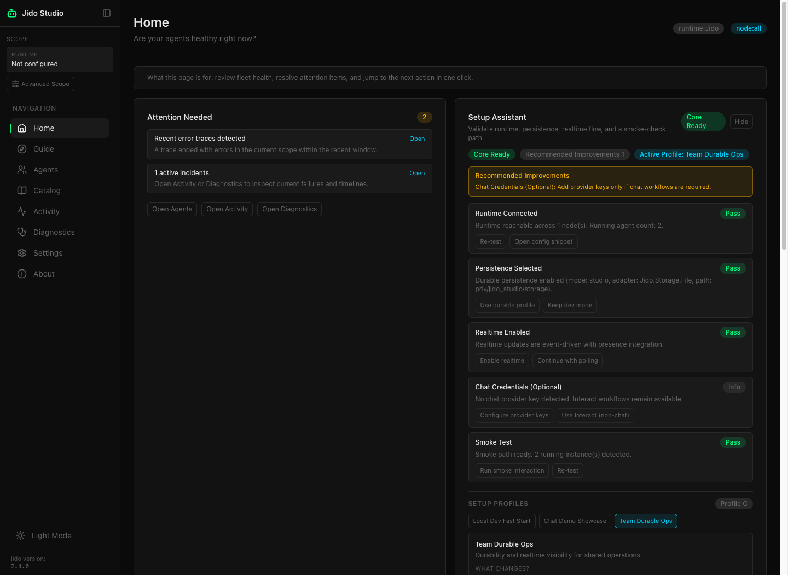
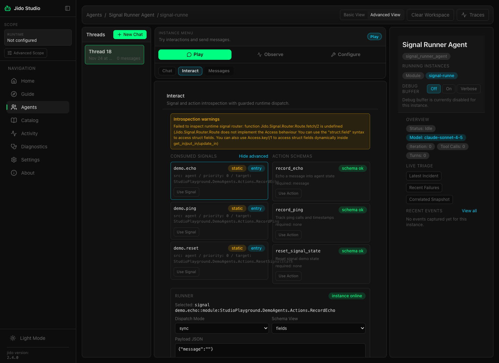
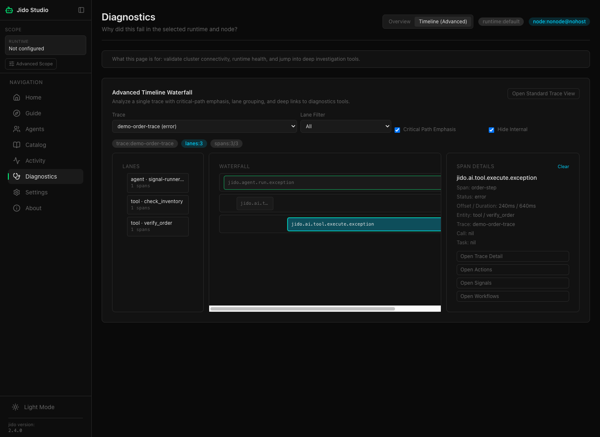

# Jido Studio v2 visual reference

Use these captures to bring the recognizable parts of v2 into the v3 shell
and into each approved feature. They show the running v2 Playground from
commit `b5aea45` with Jido and Jido AI `2.4.0`. The
[feature checklist](../../roadmaps/jido-studio-v2-features.md) identifies
the behavior to restore with each screen.

## Screenshot index

Capture date is 2026-11-24. Desktop captures are 1440 × 1050 browser pixels.
The narrow Agents capture uses a 390 × 844 viewport with the sidebar
collapsed. Each image shows one viewport. For long pages, the file records
the relevant visible section.

| Surface | Captured states |
| --- | --- |
| Home and shell | [Dark](screenshots/home-dark.png), [light](screenshots/home-light.png), [advanced scope open](screenshots/shell-advanced-scope.png) |
| Agent inventory | [Active instances](screenshots/agents.png), [discovered modules](screenshots/agents-discovered.png), [narrow with sidebar collapsed](screenshots/agents-mobile.png) |
| Agent workbench | [Basic View](screenshots/agent-basic.png), [Play and Interact](screenshots/agent-interact.png), [runner controls](screenshots/agent-runner-controls.png), [Observe](screenshots/agent-observe.png), [Configure](screenshots/agent-configure.png), [start-instance dialog](screenshots/agent-start-modal.png) |
| Chat | [Conversation](screenshots/agent-chat.png), [new thread](screenshots/agent-chat-empty.png) |
| Catalog | [Agent list and selected entry](screenshots/catalog.png) |
| Activity | [Operational timeline](screenshots/activity.png) |
| Diagnostics | [Overview](screenshots/diagnostics.png), [waterfall with selected error span](screenshots/diagnostics-waterfall.png) |
| Traces | [Trace list](screenshots/traces.png), [error trace detail](screenshots/trace-detail.png) |
| Signals, Actions, and Workflows | [Signals](screenshots/signals.png), [Actions list](screenshots/actions.png), [Action Detail](screenshots/action-detail.png), [workflow runs](screenshots/workflows.png), [workflow detail](screenshots/workflow-detail.png) |
| Threads | [Empty list](screenshots/threads-empty.png), [populated list](screenshots/threads.png), [entry detail](screenshots/thread-detail.png) |
| Guide, Settings, and About | [Guide](screenshots/guide.png), [active tour controls](screenshots/guide-tour.png), [Setup Assistant in Settings](screenshots/settings.png), [About](screenshots/about.png) |
| Optional extensions | [Messaging Rooms](screenshots/messaging-rooms.png) |

## Layout and components

| Area | v2 reference |
| --- | --- |
| Global shell | A full-height frame. The sidebar is 220 px wide when expanded and 48 px wide when collapsed. Brand and scope sit above the scrolling navigation. The theme control and Jido version sit at the bottom. The active route has a border marker and a raised background. |
| General pages | A 24 px semibold title, 14 px subtitle, a right-side action and scope area, and a divider. Section cards use a thin border, rounded corners, and a visible change of surface. The main page scrolls. |
| Lists and details | Keep search and filters above the results. Put details next to the list when there is room. Use dense labeled columns, monospace identifiers, and badges with status text. Show a useful empty or unavailable state in the same surface. |
| Basic workbench | The upper bar shows breadcrumbs, Basic or Advanced View, and a trace link. The main area leads with the starter operation, inputs and run, result, state change, and possible next action. |
| Advanced workbench | The desktop view has a left thread rail, a flexible center workspace, and a right instance summary rail. The top bar stays visible. The center has Play, Observe, and Configure sections above the section tabs. The panes scroll separately on desktop. |
| Diagnostics waterfall | Group time bars by lane. Keep the span detail and links visible beside the chart. Show selection, error status, and critical path with distinct treatments. |
| Components | Rounded buttons, bordered cards, count cards, pill badges, status dots, dense tables, tabs, empty states, and dialogs. Lucide line icons accompany controls. System sans-serif is the default. Use monospace for IDs, trace fields, and payloads. |

[Shell source](../../../lib_old/jido_studio/layouts.ex) ·
[Components](../../../lib_old/jido_studio/components.ex) ·
[Advanced workbench](../../../lib_old/jido_studio/live/agents_live/render/advanced_instance_view.ex) ·
[Diagnostics components](../../../lib_old/jido_studio/diagnostics/components.ex)

## Theme values

These are the v2 values from the [theme stylesheet](../../../assets/jido_studio.css).
They record the visual source. Check contrast and focus when you apply them
to controls or body text in v3.

| Role | Dark | Light |
| --- | --- | --- |
| Canvas | `#0A0A0A` | `#FCF9F4` |
| Card | `#121212` | `#FFFFFF` |
| Raised surface | `#1A1A1A` | `#F5F2EB` |
| Sidebar | `#0D0D0D` | `#F7F4EF` |
| Border | `#292929` | `#E7E5E2` |
| Text | `#E8E8E8` | `#1B1916` |
| Muted text | `#666666` | `#756E65` |
| Primary and success | `#00FF80` | `#0FA968` |
| Information and trace links | `#00D4FF` | `#0BA5C4` |
| Warning | `#FFB700` | `#D68B00` |
| Error | `#E06C6C` | `#E53E3E` |

## Apply the design in small changes

1. Start with the shell, theme roles, and current page. Keep the v3 host
   layout and LiveView client. Keep Studio styling inside the Studio mount.
2. Apply shared headings, cards, table rows, controls, and status treatments
   as the first real pages need them. Add sidebar links when their pages exist.
3. Use the v2 Agent and Diagnostics captures when those workflows are
   approved. Keep breadcrumbs, scope, and the selected item visible.
4. Compare each new view with its corresponding capture at desktop and
   narrow widths. Check focus, contrast, label wrapping, and scrolling. The
   narrow v2 capture shows constraints to improve. It is a record of what
   v2 rendered.

## Capture evidence and limits

- The captures came from connected Phoenix LiveViews in local Chrome. The
  temporary v2 copy used the original code and compiled Studio CSS. It ran
  separately from the v3 playground.
- The original Signal Runner and Device Control agents provided the non-chat
  workbench screens. The workflow, failed trace, action history, and populated
  thread contain demo records. The Interact capture shows the v2 runtime
  route inspection warning and the static route fallback.
- The Chat screens use the archived [Calculator Agent test fixture](../../../test_old/support/jido_ai_examples.ex)
  and a saved sample conversation. A local placeholder enabled the composer.
  The capture made no provider calls. Messaging Rooms uses a local fixture
  that supplies the two sample rooms through the v2 provider interface.
- The active tour controls appeared below the shell. The v2 tour script
  creates the controls and adds a class to the target. The shipped stylesheet
  lacks the rules for the overlay and target highlight. Use the Guide capture
  for card design and the active tour capture for the step content.
- The captures preserve current viewport scroll and clipping. They give
  visual evidence for the selected states. The feature checklist also uses
  archived code and tests for other states.

To reproduce the view, extract commit `b5aea45` into a separate directory,
build the original `dev/studio_playground`, and use a different local port
from the v3 playground. The original app includes two non-chat demo agents.
The archived [diagnostics tests](../../../test_old/jido_studio/diagnostics_live_test.exs)
and [thread tests](../../../test_old/jido_studio/threads_explorer_test.exs)
show how to populate selected evidence.
